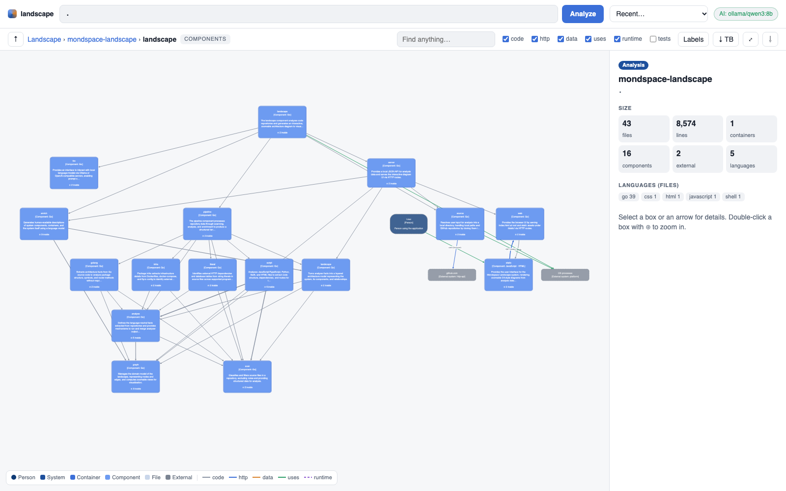
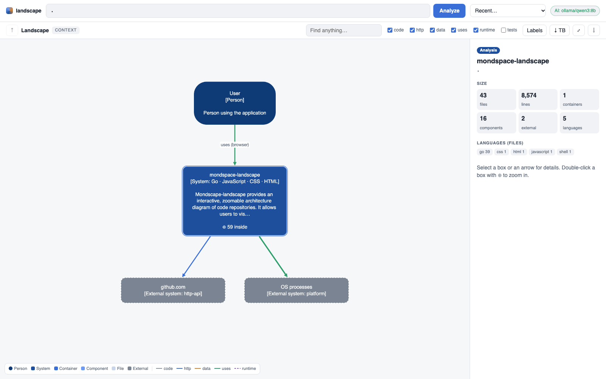
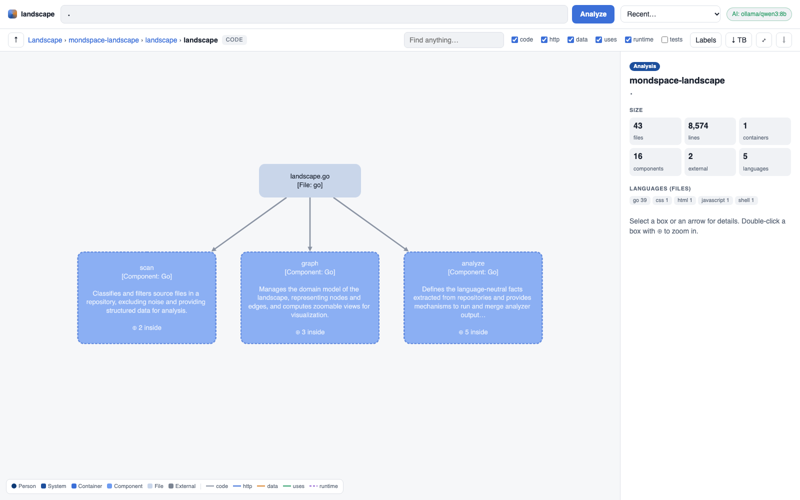

# mondspace-landscape

**Turn any codebase into a zoomable, C4-style architecture map — analyzed locally, explained by a local model.**

`landscape` reads a repository with fast static analysis, assembles a layered model of
the software (people → system → containers → components → files, plus the external
systems it talks to), asks a local LLM (Ollama or LM Studio) to describe each part in
plain language, and opens an interactive diagram in your browser. Nothing leaves your
machine.

<picture>
  <source media="(prefers-color-scheme: dark)" srcset="docs/images/components-dark.png">
  
</picture>

<sub>☝️ This is `landscape` analyzing <b>its own repository</b> (components level). Every image in this README is generated by the tool itself with <code>make screenshots</code>.</sub>

> **Status: v0.1.1-alpha.** The foundation — analysis and diagram drawing — is in place and
> tested. Expect rough edges and heuristics that are wrong for some repositories.
> [Feedback and issues welcome](https://github.com/mondial7/mondspace-landscape/issues).

---

## Why

Discussing software is hard when everyone holds a different picture of it in their head.
Architecture diagrams help, but hand-drawn ones go stale and auto-generated ones are
usually a single, unreadable hairball. `landscape` aims at the middle:

- **Generated from the code**, so it is always current — no modelling language to maintain.
- **Layered and zoomable**, so you can talk about the whole system *or* one package without
  drowning in detail. Relationships are lifted to whatever level you are looking at.
- **Explained in plain language** by a model running on your laptop, so non-authors can follow.
- **Local-first and lightweight**: one Go binary, no accounts, no cloud, no telemetry.

## Install

```sh
brew install mondial7/tap/mondspace-landscape
```

or, with Go 1.26+:

```sh
go install github.com/mondial7/mondspace-landscape/cmd/landscape@latest
```

or download an archive from the [releases page](https://github.com/mondial7/mondspace-landscape/releases).

For plain-language descriptions, run [Ollama](https://ollama.com) (e.g. `ollama pull qwen3:8b`)
or [LM Studio](https://lmstudio.ai) with any chat model loaded. Without a model you still get
the full diagram from static analysis.

## Use

```sh
landscape                                   # analyze the current directory and open the diagram
landscape ~/code/my-service                 # analyze a local repository
landscape github.com/charmbracelet/glow     # clone (shallow) and analyze a public GitHub repo
landscape serve                             # just open the UI and paste repositories there
landscape --json . > landscape.json         # print the model as JSON (no UI)
```

In the browser:

| Action | How |
| --- | --- |
| Zoom into a box (⊕ marks boxes with content) | double-click, or select + <kbd>Enter</kbd> |
| Zoom out | <kbd>Backspace</kbd>, the ↑ button or the breadcrumb |
| Details, connections, routes, SQL tables | click a box or an arrow |
| Find anything in the whole model | <kbd>/</kbd> |
| Filter relationship kinds, show tests, flip layout, export PNG | toolbar |

Every view has its own URL (`#/a/<analysis>/<node>`), so the browser's back button works and
you can point a colleague at the exact level you are discussing.

### The levels

| Level | Shows | Example |
| --- | --- | --- |
| **Context** | the system, its users and external systems | User → *shop* → PostgreSQL, Stripe |
| **Containers** | runnable/deployable parts | Go web server, CLI, iOS app, landing page |
| **Components** | packages / source directories | `server`, `store`, `templates` |
| **Code** | files of a component and what they reach | `server.go` → `store` |

<table>
<tr>
<td><picture><source media="(prefers-color-scheme: dark)" srcset="docs/images/context-dark.png"></picture></td>
<td><picture><source media="(prefers-color-scheme: dark)" srcset="docs/images/code-dark.png"></picture></td>
</tr>
<tr><td align="center"><sub>Context</sub></td><td align="center"><sub>Code (inside the <code>landscape</code> package)</sub></td></tr>
</table>

### Relationships

| Kind | Meaning | Found from |
| --- | --- | --- |
| `code` | one part imports / references another | imports, `//go:embed`, Swift type references |
| `http` | HTTP calls, matched to the route that serves them | `fetch`, `axios`, htmx `hx-*`, forms, links ↔ Go/Express/FastAPI/Flask routes; absolute URLs in code |
| `data` | reads/writes a data store, with table names | DB drivers + SQL in string literals; file writes |
| `uses` | people using UIs, processes, platform services | entry points, UI frameworks, `os/exec`, iOS frameworks |
| `runtime` | deployment relations | Dockerfile, docker-compose (`depends_on`, backing services), fly.toml |

## How it works

```
 repo ─▶ scan ─▶ analyzers ─────────────▶ facts ─▶ landscape ─▶ graph ─▶ views ─▶ browser
         (files,   go · js/ts · python ·    (units,   (containers,   (hierarchy  (lifted to
          langs,   swift · html · infra ·    deps,     components,    + typed     the zoom
          ignore)  literals                  routes…)  people, flows) edges)      level)
                                                            │
                                                            └─▶ enrich (local LLM, bottom-up:
                                                                components → containers → system)
```

- **Analyzers** are small and independent: they only report *facts* (units of code,
  dependencies, routes, calls, SQL tables, external systems, services). Go uses the standard
  library parser (no build needed); other languages use lightweight pattern matching.
- **The landscape assembler** is the only place with architecture heuristics: which entry
  points become containers, which packages belong to which container (import reachability,
  embeds, module roots), how UI calls match server routes, where data flows.
- **The graph** is a plain hierarchy with typed edges. A *view* shows the children of one
  node plus the outside nodes they interact with, with every underlying edge lifted to the
  nearest visible ancestor — that is what makes zooming feel natural.
- **Enrichment** runs after the diagram is already visible; descriptions stream in as the
  model writes them. The model never sees more than a short excerpt of each component.

### Language support (v0.1)

| | Units | Dependencies | Routes / calls | Externals |
| --- | --- | --- | --- | --- |
| Go | packages | imports (per file), `//go:embed` | `net/http`, chi/echo/gin-style routers | DB drivers, cloud SDKs, AI APIs, `os/exec`, file writes, URLs |
| JavaScript / TypeScript | directories, `package.json` roots | relative imports | Express/Fastify routes; `fetch`, `axios` | npm packages (DBs, cloud, Stripe, AI…), URLs |
| Python | directories | absolute & relative imports | FastAPI/Flask decorators | DB drivers, boto3, AI SDKs, `subprocess`, URLs |
| Swift | folders, Xcode targets, SwiftPM modules | type references (intra- and cross-module) | — | CloudKit, StoreKit, HealthKit, SwiftData… |
| HTML templates | directories | — | links, forms, htmx | CDN URLs |
| Infra | — | — | — | Dockerfile, docker-compose, fly.toml |

## Privacy & security

- The server listens on `127.0.0.1` only and rejects foreign `Host` headers (DNS rebinding).
- The API only accepts JSON bodies, so other websites cannot trigger analyses via forms.
- Repository content is treated as untrusted: the UI renders it as text, never HTML.
- Remote repositories are shallow-cloned into your user cache directory; git never prompts
  for credentials (private repositories fail fast).
- Model calls go only to the local Ollama / LM Studio endpoints you configure.

## Flags

```
--port 7878           port for the web UI (0 = any free port)
--no-open             do not open the browser
--json                print the landscape as JSON and exit
--llm auto            local model provider: auto, ollama, lmstudio, none
--model NAME          model to use (default: best installed chat model)
--ollama-url URL      Ollama base URL (default $OLLAMA_HOST or http://localhost:11434)
--lmstudio-url URL    LM Studio / OpenAI-compatible URL (default $LMSTUDIO_URL or http://localhost:1234)
--max-ai 60           maximum components described by the model (largest first)
--ai-workers 2        concurrent model requests
--cache DIR           where remote repositories are cloned
```

## Development

The project is built test-first; every package has its tests next to it.

```sh
make test          # go test ./... -race
make run           # analyze this repo and open the UI
make screenshots   # regenerate the README/Pages images with the tool itself (needs Chrome)
make help          # everything else
```

```
cmd/landscape        CLI: flags, wiring, local server lifecycle
internal/scan        file walk, language detection, .gitignore, test detection
internal/analyze     the Facts contract, analyzer runner, library catalog, route & SQL helpers
  ├─ golang          Go analyzer (go/parser)
  ├─ script          JS/TS, Python, Swift, HTML analyzers
  ├─ infra           Dockerfile, docker-compose, fly.toml
  └─ literal         URLs and SQL in string literals (language-agnostic)
internal/landscape   facts → layered architecture model (all heuristics live here)
internal/graph       hierarchy, typed edges, zoomable views with edge lifting
internal/llm         Ollama + OpenAI-compatible clients, model auto-detection
internal/enrich      bottom-up descriptions with a local model
internal/pipeline    scan → analyze → assemble → enrich
internal/source      local paths and GitHub URLs → local checkout (cache)
internal/server      local JSON API, async analysis jobs
internal/web         embedded UI (vanilla JS + Cytoscape.js + dagre)
```

Adding a language means writing one analyzer that emits `analyze.Facts`; recognising a new
library is one line in `internal/analyze/catalog.go`.

## Roadmap

- Comments and annotations on nodes, shareable as a file next to the code
- More languages (Kotlin, Java, Rust, Ruby, C#) and frameworks
- Kubernetes manifests and Terraform as first-class runtime layers
- Diffs: what changed in the architecture between two commits / in a pull request
- Caching of analyses and model descriptions
- Export to Mermaid / Structurizr / LikeC4

## Credits

Diagram rendering by [Cytoscape.js](https://js.cytoscape.org) and
[cytoscape-dagre](https://github.com/cytoscape/cytoscape.js-dagre) (MIT, vendored).
Inspired by the [C4 model](https://c4model.com).

## License

[MIT](LICENSE)
